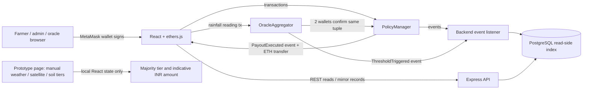

# AgriShield Blockchain Implementation and Viva Guide

## What the project actually implements

AgriShield is a local Ethereum-style prototype built with Solidity, Hardhat, ethers.js, React, Express, and PostgreSQL. Its tested blockchain flow uses **one rainfall value** submitted by two authorized oracle wallets. If both submit the same region, time-window, and rainfall tuple, the contract checks that value against the policy's rainfall threshold and pays the policy's fixed ETH amount.

The report describes three source types—weather, satellite crop health, and soil moisture—but the running contracts and backend do not fetch or combine those datasets. The `/prototype` page added for the submission is an illustrative front-end calculation: its three tier controls are manually selected values and its payout percentages are computed in React. Those percentages are not enforced by the existing contracts. Keep that distinction clear in the demonstration.

## Architecture and data flow



The proposed three-dataset path is not connected to the on-chain flow. In the running DApp, oracle wallets confirm one exact rainfall tuple; they are not three named providers.

## Run commands and verified local configuration

The repository README describes these services and commands:

1. Start PostgreSQL and load `backend/src/db/schema.sql` if the local database is absent.
2. In `contracts/`, run `npx hardhat node`.
3. In another terminal, run `npx hardhat run scripts/deploy.js --network localhost`.
4. In `backend/`, run `npm run dev` after configuring the database and contract addresses.
5. In `frontend/`, run `npm run dev`; use the local prototype at `/prototype` or the authenticated DApp pages.

The checked-in frontend `.env` points to `http://127.0.0.1:8545` and the deterministic local Hardhat deployment addresses. The Hardhat development chain uses chain ID 31337. The MetaMask network must point to that RPC and chain ID for wallet transactions to reach the local contracts. The frontend obtains its transaction provider from the injected wallet (`window.ethereum`); `VITE_RPC_URL` is exported from config but the wallet context does not use it to sign transactions.

Hardhat tests passed: **15 passing** using the already-built artifacts (`npx hardhat test --no-compile`). A plain `npx hardhat test` stalled at Hardhat's compiler step in this environment, so I stopped it and used the existing artifacts. The local end-to-end deployment and `scripts/verify-flow.js` also ran successfully. PostgreSQL and the backend were not reachable during this verification (`localhost:5432` and `localhost:4000` refused connections); their prior log file contains an earlier successful start, but that is not evidence they are currently running.

No public network was used. No private keys or secrets are included here. Do not use the known Hardhat development accounts on a live network.

## Contract files and stored data

### `contracts/contracts/PolicyManager.sol`

Owns the templates, policies, reserve balance, and payouts. Stored fields include:

- Template: rainfall threshold, premium, fixed payout amount, season start/end, region ID, active flag.
- Policy: farmer wallet address, template ID, purchase timestamp, region ID, status (`Active`, `Paid`, or `Expired`).
- Index mappings: template and policy counts, policies by farmer and by region.
- Owner and the linked `OracleAggregator` address.

The contract does not store farmer name/email, plot geometry, a land hash, satellite values, soil readings, or a dispute record.

### `contracts/contracts/OracleAggregator.sol`

Owns the authorized oracle-wallet list, required confirmation count, and per-reading-key confirmation flags/counts. A reading key is `keccak256(abi.encodePacked(regionId, windowStart, rainfallMM))`. This means consensus is reached only when wallets submit the exact same three values. It does not average nearby readings or combine weather, satellite, and soil tiers.

### Function guide

| Function | Purpose and checks | State-changing transaction? |
|---|---|---|
| `PolicyManager.setOracleAggregator(address)` | Owner links the payout caller; rejects the zero address; emits `OracleAggregatorSet`. | Yes |
| `PolicyManager.createTemplate(...)` | Owner adds a template; requires season end after start; increments count and emits `TemplateCreated`. | Yes |
| `PolicyManager.deactivateTemplate(id)` | Owner turns off a template. No event is emitted and no explicit ID-exists check is made. | Yes |
| `PolicyManager.purchasePolicy(templateId)` | Payable; requires active template, exact premium, and current time no later than season end; stores policy and emits `PolicyPurchased`. It does not check season start or duplicate land. | Yes, with ETH |
| `PolicyManager.fundReserve()` / `receive()` | `fundReserve` is owner-only and payable; the contract's plain receive path accepts ETH from any sender. Both emit `ReserveFunded`. | Yes, with ETH |
| `PolicyManager.executePayout(policyId)` | Only linked aggregator; requires active policy and sufficient contract balance; marks `Paid` before sending the template's fixed amount; emits `PayoutExecuted`. | Yes, transfers ETH |
| `getPoliciesByRegion`, `getFarmerPolicies`, `getPolicy`, public mappings | Read stored values. | No, when called as `view` / read-only RPC calls |
| `OracleAggregator.addOracle(address)` | Owner only; rejects zero/already-authorized address; updates allowlist/count; emits `OracleAdded`. | Yes |
| `OracleAggregator.removeOracle(address)` | Owner only; requires currently authorized address; updates allowlist/count; emits `OracleRemoved`. | Yes |
| `OracleAggregator.submitReading(regionId, rainfallMM, windowStart)` | Authorized wallet only; rejects duplicate submission by that wallet for the exact reading key; increments confirmations and invokes evaluation when count reaches threshold; emits `ReadingSubmitted` and then, during evaluation, `ThresholdTriggered`. | Yes |
| `_checkAndTrigger(...)` | Internal; scans active policies in the region; for each active template, pays if rainfall is strictly below the threshold. | Runs within the oracle transaction |

`contracts/contracts/OracleAggregator.sol` declares `IPolicyManager` as the interface used to read templates/policies and call `executePayout`.

### Key code paths

From `OracleAggregator.submitReading` (original project logic):

```solidity
bytes32 eventKey = keccak256(abi.encodePacked(_regionId, _windowStart, _rainfallMM));
require(!hasConfirmed[eventKey][msg.sender], "Already confirmed by this oracle");
hasConfirmed[eventKey][msg.sender] = true;
confirmationsForEvent[eventKey]++;

if (confirmationsForEvent[eventKey] >= requiredConfirmations && !eventTriggered[eventKey]) {
    eventTriggered[eventKey] = true;
    _checkAndTrigger(_regionId, _rainfallMM, _windowStart);
}
```

The contract is counting distinct authorized wallets for one exact reading tuple. `requiredConfirmations` defaults to 2 in `contracts/scripts/deploy.js`.

From `OracleAggregator._checkAndTrigger`:

```solidity
if (active && _rainfallMM < threshold) {
    policyManager.executePayout(ids[i]);
}
```

From `PolicyManager.executePayout`:

```solidity
require(p.status == PolicyStatus.Active, "Policy not active");
require(address(this).balance >= t.payoutAmount, "Insufficient reserve");
p.status = PolicyStatus.Paid; // state changes before the external transfer
(bool sent, ) = payable(p.farmer).call{value: t.payoutAmount}("");
require(sent, "Payout transfer failed");
emit PayoutExecuted(_policyId, p.farmer, t.payoutAmount);
```

The status update before the external call prevents the same active policy from being paid twice through a re-entrant call. The code does not import an audited reentrancy guard and the full system has not been security-audited.

### Events

- `TemplateCreated`, `PolicyPurchased`, `PayoutExecuted`, `ReserveFunded`, `OracleAggregatorSet` (`PolicyManager`).
- `OracleAdded`, `OracleRemoved`, `ReadingSubmitted`, `ThresholdTriggered` (`OracleAggregator`).

Events are transaction logs. They can be indexed by a node/backend and independently checked against the transaction receipt. They are not a private database.

## Frontend, API, and transaction flow

1. `WalletContext.jsx` checks for `window.ethereum`, requests accounts with `eth_requestAccounts`, creates an ethers `BrowserProvider`, and obtains a signer. The signer creates `Contract` instances at the configured addresses.
2. The admin page calls contract write functions for reserve funding, template creation, and oracle authorization. The farmer's `TemplatesPage.jsx` calls `purchasePolicy`; the oracle simulator calls `submitReading`.
3. Each path awaits `tx.wait()`. Admin template creation and policy purchase parse the relevant contract event from `receipt.logs` to get the on-chain ID. The oracle simulator displays the receipt block number. These pages retain/display a transaction hash in progress or in the resulting record.
4. The frontend then sends a REST request to Express to mirror a reading/template/policy action in PostgreSQL. This mirror is off-chain and does not make the chain transaction happen.
5. `backend/src/services/blockchainListener.js` listens for `PolicyPurchased`, `PayoutExecuted`, and `ThresholdTriggered`. It stores event transaction hashes and block numbers in `blockchain_tx_log`; on `PayoutExecuted`, it also updates the indexed policy and inserts a payout row.
6. The policy detail page polls the API every five seconds and reads the policy directly from the contract through the backend's read-only provider for a chain status cross-check. The auditor page reads the backend index, not a direct block explorer.

`tx.wait()` waits for mining and in ethers normally rejects if the transaction reverts, but the UI code does not explicitly assert `receipt.status === 1`. The local flow's payout receipt was separately checked: status `0x1`, block 10, gas used 155,216. The frontend does not show a block explorer link. The listener records block numbers for the three events it handles, but does not subscribe to `ReadingSubmitted` or `TemplateCreated`; those are mirrored by frontend API calls instead.

The SQL schema stores accounts, role, wallet address, region names, template/policy indexes, submitted rainfall mirror records, payout indexes, transaction logs, and audit rows. PostgreSQL is an application/query cache; contract state and receipts are the blockchain source of truth for the values actually written on-chain. Names, email, password hash, and other application data stay off-chain.

## Percentage calculations: what they mean

There are two different mechanisms in the repository:

1. **Interactive `/prototype` page:** four hard-coded tier rates are `[0, 0.25, 0.5, 1]`. Three manually selected tier numbers are counted, the most common tier wins, and the page calculates `insuredAmount × rate`. These percentages mean **indicative compensation as a share of the sum insured**. They are not confidence, source contribution, or progress. This calculation is frontend-only, using JavaScript in `frontend/src/pages/PrototypePage.jsx`.
2. **On-chain DApp:** there is no percentage formula. `PolicyManager` pays the `payoutAmount` stored in the template. In the end-to-end script, that amount is 0.1 ETH. Oracle agreement is a count (2 confirmations), not 25%, 50%, or 66.7% confidence.

The `/prototype` page defaults to weather tier 2, satellite tier 2, soil tier 1, and sum insured ₹100,000. Two votes select tier 2 (50%): `₹100,000 × 0.5 = ₹50,000`. If a majority instead selected tier 1, the same code would calculate `₹100,000 × 0.25 = ₹25,000`; tier 0 gives ₹0 and tier 3 gives ₹100,000. These are deterministic examples from the UI defaults/rates, not measured crop-loss estimates or real oracle results.

## Blockchain properties, stated accurately

| Property | Simple explanation | Evidence and concrete project example | Status / limit |
|---|---|---|---|
| Decentralization | Independent nodes can share control of a ledger. | Current config uses local Hardhat at `127.0.0.1:8545`; one local process and one deployer/owner control this demo. | **Not decentralized as run.** Sepolia settings are only placeholders; no testnet/public deployment was verified. |
| Immutability | Confirmed chain history is difficult to rewrite under the network's rules. | Contract transactions change template/policy/allowlist state and emit logs. | **Partial / network-dependent.** Local Hardhat state can be reset; the owner can deactivate templates; PostgreSQL can be edited; oracle input truth is not guaranteed. |
| Transparency and verifiability | Public state and transaction logs can be inspected and checked. | Public contract getters plus `PolicyPurchased` / `PayoutExecuted` events; verified local payout receipt. | **Implemented on the local chain for contract data.** The auditor UI is a DB index, and there is no public explorer link in the UI. |
| Security | Rules and permissions limit who can perform actions and how funds move. | `onlyOwner`, `onlyAuthorizedOracle`, and `onlyOracleAggregator`; exact premium and reserve checks; status set before payout transfer. | **Partial, demo only.** Registration lets a user choose admin/oracle role; no audit; no real data provenance; no duplicate-land protection; configuration/secrets require deployment hardening. |
| Traceability | A record can be followed through a transaction hash, event, entity ID, and block. | Listener writes tx hash and block number; local payout hash and block 10 verified. | **Partial.** Some events are indexed while others are mirrored by frontend requests; the auditor table truncates hashes and shows no block column. |
| Integrity | Unauthorized changes are prevented or later changes become detectable. | Contract state can only be changed through transactions satisfying the contract checks; SQL is a mutable read-side index. | **Partial.** Contract state is protected by access checks; arbitrary oracle data is accepted from allowlisted wallets and data source calculations are not verified. |
| Consensus | The network decides which transactions/blocks form its ledger. | Running network is Hardhat's local development chain, which simulates a node and mines local transactions. | **Network-level, local simulation.** Ethereum mainnet uses Proof of Stake, but that is not the current configured network. The oracle's 2-wallet rule is application-level agreement, not blockchain consensus. |
| Smart contracts | On-chain code enforces rules automatically when transactions call it. | Premium equality, season-end purchase cutoff, oracle allowlist, exact reading confirmations, rainfall threshold, reserve sufficiency, one payout per active policy. | **Implemented for this rainfall/fixed-payout path.** Three-source tiers, duplicate land, fraud flags, disputes, and percentage settlement are not enforced on-chain. |

## Demonstration sequence and expected output

### Interactive prototype page

1. Open `/prototype`.
2. Leave sample tiers at 2, 2, and 1; leave sum insured at ₹100,000.
3. Choose **Evaluate sample reports**. The page shows tier 2 / 50% and indicative ₹50,000.
4. Try a duplicate example by entering `ANP-KHA-042`; registration/evaluation disables. Toggle field-officer review or submit a dispute to see the review state.
5. Explain that this page is an illustrative calculation, does not sign a blockchain transaction, and has no external dataset feed.

### Local on-chain rainfall flow

1. Start Hardhat, deploy contracts, and ensure the front-end/backend addresses match the new local deployment.
2. Admin funds the reserve, creates a region-1 template with rainfall threshold 50 mm, premium 0.01 ETH, and fixed payout 0.1 ETH, then authorizes two oracle wallets.
3. A farmer purchases the template by paying the exact premium.
4. Two authorized oracle wallets each submit region 1, rainfall 30 mm, and the same window timestamp. After the first, policy status remains Active; after the second, `30 < 50` and the policy is marked Paid; `PayoutExecuted` transfers 0.1 ETH.
5. Show the transaction hash and `PayoutExecuted` receipt. The backend indexer can display the event if PostgreSQL/backend are running.

## Likely viva questions

1. **Which blockchain does this prototype use?** Solidity contracts run on a local Hardhat development chain for this verified demo; Sepolia is only an optional configuration, not a verified deployment.
2. **What does the OracleAggregator do?** It accepts readings from allowlisted wallets, counts confirmations for an exact region/time/rainfall tuple, and after the configured count checks active policies in that region.
3. **Are weather, satellite, and soil data fetched automatically?** No. They are described in the report and shown as manual sample tier controls on `/prototype`; the contracts/backend currently process rainfall only.
4. **What does 50% mean on the prototype page?** It is the hard-coded tier-2 share of the insured sum. For ₹100,000, the indicative amount is ₹50,000.
5. **Does the on-chain contract calculate 25% or 50%?** No. It transfers the fixed `payoutAmount` stored on the template. The verified demo uses 0.1 ETH.
6. **What is 2-of-N agreement?** Two different authorized wallets must confirm the same region, windowStart, and rainfall value. The contract is not averaging data and does not calculate a percent confidence.
7. **What happens if the wallets submit different rainfall amounts?** They create different event keys, so their confirmations do not combine toward one payout.
8. **Where is personal farmer information stored?** The contract stores the farmer's wallet address, not their name/email. Names, email, password hash, and user roles are in PostgreSQL.
9. **How is a policy purchase verified?** The frontend signs `purchasePolicy`, waits for the transaction receipt, parses `PolicyPurchased` for the ID, and then mirrors the record in the API/database.
10. **How can an auditor trace a payout?** Check `PayoutExecuted` in the transaction receipt/logs using the transaction hash and block number; the backend also indexes the event for its auditor page.
11. **Is this fully decentralized?** No. The tested configuration is a local single-node Hardhat chain; admin/owner control remains, and PostgreSQL/backend provide centralized application services.
12. **What does immutable mean here?** A confirmed transaction is recorded in the chain history and is difficult to change under that network's rules, but local state can reset and immutable storage cannot make false oracle data true.
13. **Which consensus algorithm is being demonstrated?** None at the application level; Hardhat simulates local mining. Ethereum Proof of Stake applies to Ethereum networks, not this current local run.
14. **How does the project control contract access?** Owner-only functions manage templates and oracle addresses; authorized oracle wallets submit readings; only the linked aggregator can call payout.
15. **Does the contract prevent duplicate insurance on the same land?** No. It stores no land hash and has no duplicate-land mapping. The duplicate-reference warning on `/prototype` is only a local mock check.
16. **Does a dispute stop an automatic payout in the DApp?** No dispute contract/state transition exists. The review toggle and dispute button are front-end demonstration states only.

## Known gaps to mention

- No Open-Meteo fetch, Sentinel-2 / Earth Engine NDVI processing, or NASA SMAP soil-moisture fetch is present in the app's execution path.
- No sensor-to-tier calibration, source provenance, basis-risk evaluation, duplicate land mapping, fraud review workflow, or on-chain dispute resolution is implemented.
- Oracle consensus requires exact equality; it does not compare the three different source types or tolerate near-equal readings.
- `register` accepts `admin` and `oracle` roles from request data, so role-based access is suitable only for a controlled demo, not public use.
- The tests verify local contract rules, not integration with real weather/satellite/soil data or insurance suitability. No security audit has been performed.
- The existing `test` npm scripts in contracts/backend are placeholders; run Hardhat tests using `npx hardhat test` (or `--no-compile` when the matching artifacts already exist).
